<div align="center">

# 💰 Dashboard Financiero en Power BI

### Modelamiento de datos · Power Query · Medidas DAX · KPIs


**Seguimiento de ingresos, gastos y utilidad de 2019 y 2020 frente a su meta y su presupuesto.**

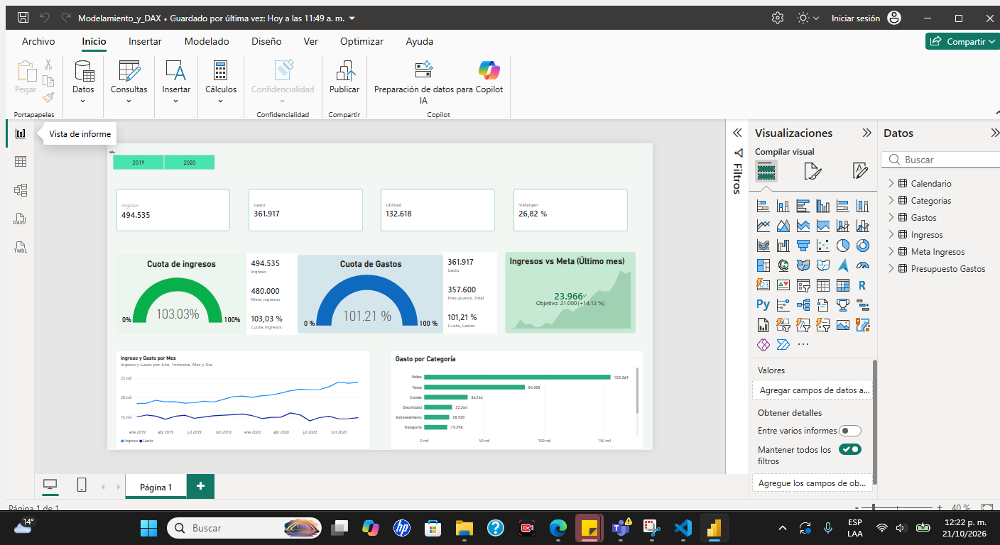

</div>

---

## 📑 Contenido

| # | Sección | Qué encontrarás |
|---|---|---|
| 1 | [📁 Archivos del repositorio](#-archivos-del-repositorio) | Qué contiene cada archivo |
| 2 | [📊 KPIs del tablero](#-kpis-del-tablero) | Valores y medida DAX de cada indicador |
| 3 | [🔄 Flujo de trabajo](#-flujo-de-trabajo) | De la fuente al tablero |
| 4 | [🧹 Power Query](#-power-query) | Las 7 consultas y sus pasos |
| 5 | [🧩 Modelo de datos](#-modelo-de-datos) | Tablas y relaciones |
| 6 | [🧮 Fórmulas DAX](#-fórmulas-dax) | Las 15 medidas con captura |
| 7 | [🔗 Match fuente ↔ modelo ↔ tablero](#-match-fuente--modelo--tablero) | Cómo se conecta cada dato |
| 8 | [🚀 Cómo usar el proyecto](#-cómo-usar-el-proyecto) | Pasos para abrirlo |

---

## 📁 Archivos del repositorio

| Archivo | Descripción |
|---|---|
| 💰 `Modelamiento_y_DAX.pbix` | **Reporte financiero**: ingresos, gastos, utilidad, metas y presupuesto |
| 👥 `Reporte_DAX.pbix` | Reporte de RRHH: colaboradores, sueldos y evaluación |
| 📗 `Datos Empleados.xlsx` | Fuente de datos del reporte de RRHH |
| 📘 [README_Dashboard_RRHH.md](README_Dashboard_RRHH.md) | Detalle técnico del reporte de RRHH |
| 🖼️ `images/` | Capturas reales de Power BI |

---

## 📊 KPIs del tablero

<table>
<tr>
<td align="center"><h3>494.535</h3><b>Ingreso</b><br/><sub><code>Ingreso</code></sub></td>
<td align="center"><h3>361.917</h3><b>Gasto</b><br/><sub><code>Gasto</code></sub></td>
<td align="center"><h3>132.618</h3><b>Utilidad</b><br/><sub><code>Utilidad</code></sub></td>
<td align="center"><h3>26,82 %</h3><b>% Margen</b><br/><sub><code>%Margen</code></sub></td>
</tr>
</table>

| Indicador | Resultado | Medida DAX |
|---|---|---|
| 🎯 Cuota de ingresos | **103,03 %** (ingreso 494.535 vs meta 480.000) | `Cuota_ingresos` |
| 🎯 Cuota de gastos | **101,21 %** (gasto 361.917 vs presupuesto 357.600) | `Cuota_Gastos` |
| 📈 Ingresos vs Meta, último mes | **23.966** (objetivo 21.000, +14,12 %) | `Ingreso`, `Meta_ingresos` |

**Otros visuales del tablero**
- 🗓️ Segmentación por **Año** (2019 / 2020).
- 📉 Línea *Ingreso y Gasto por Mes*.
- 📊 Barras *Gasto por Categoría*: Online 155.369 · Renta 84.000 · Comida 36.246 · Electricidad 23.264 · Entretenimiento 20.930 · Transporte 19.298.

---

## 🔄 Flujo de trabajo

```
 Fuentes de datos  ──▶  Power Query  ──▶  Modelo relacional  ──▶  Medidas DAX  ──▶  Tablero
 (7 tablas)             limpieza y        estrella: Calendario    15 medidas        KPIs, indicadores,
                        transformación    y Categorias            y cuotas          líneas y barras
```

---

## 🧹 Power Query

Siete consultas, cada una con sus pasos aplicados.

| Consulta | Filas | Pasos clave |
|---|---:|---|
| 📅 `Calendario` | 731 | Consulta anexada con `Calendario2020`; se agregan `Inicio del mes` y `Año` (`Date.Year([Fecha])`) |
| 📅 `Calendario2020` | — | Segunda mitad del calendario; queda oculta en el modelo porque solo sirve para el anexo |
| 🏷️ `Categorias` | 10 | Encabezados promovidos y tipos de texto; `Cat-Otros` agrupa todas las categorías como «Otros» excepto «Online» |
| 💸 `Gastos` | 216 | Filas superiores quitadas, encabezados promovidos, columna sobrante quitada y `Cantidad` renombrada a `Gastos` |
| 💵 `Ingresos` | 48 | Mismo patrón: `Cantidad` renombrada a `Ingresos` |
| 🧾 `Presupuesto Gastos` | 216 | Anulación de dinamización de columnas, columna personalizada, reordenar columnas y `FECHA` renombrada a `Fecha` |
| 🎯 `Meta Ingresos` | 24 | Columna personalizada, reordenar y quitar columnas, `Fecha` como tipo fecha |

**Calendario** (731 filas, de 2019 a 2020):
`Origen → Navegación → Encabezados promovidos → Tipo cambiado → Consulta anexada → Columnas con nombre cambiado → Inicio del mes insertado → Año insertado`

<details open>
<summary><b>📸 Capturas de Power Query</b></summary>
<br/>

<p align="center">
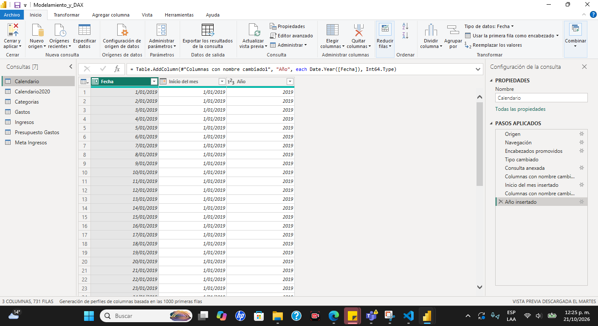<br/>
<sub>Calendario</sub>
</p>

<table>
<tr>
<td width="50%" align="center">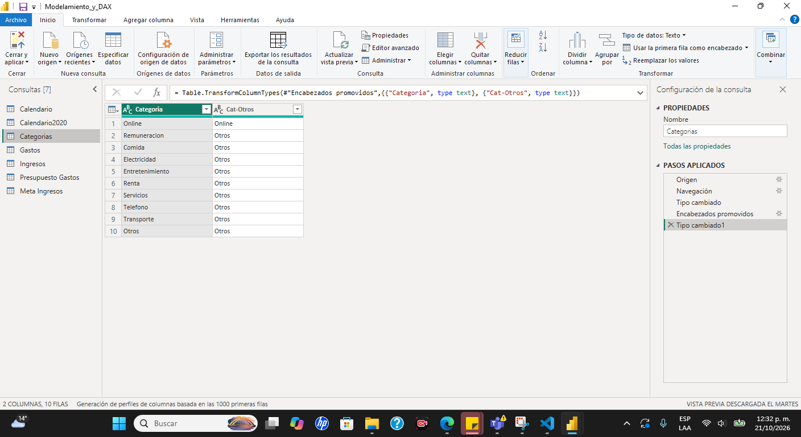<br/><sub>Categorias</sub></td>
<td width="50%" align="center">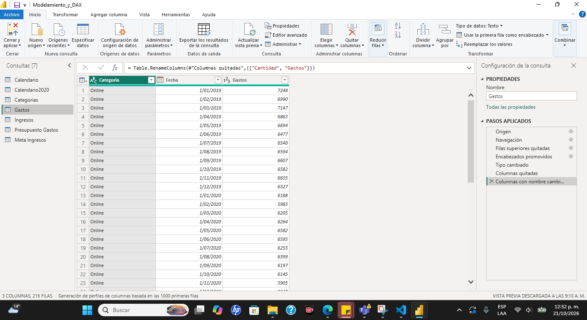<br/><sub>Gastos</sub></td>
</tr>
<tr>
<td width="50%" align="center"><br/><sub>Ingresos</sub></td>
<td width="50%" align="center">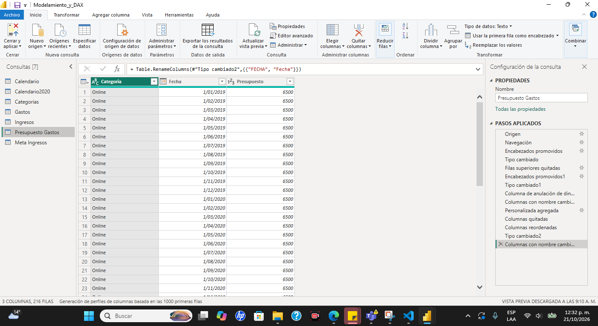<br/><sub>Presupuesto Gastos</sub></td>
</tr>
</table>

<p align="center">
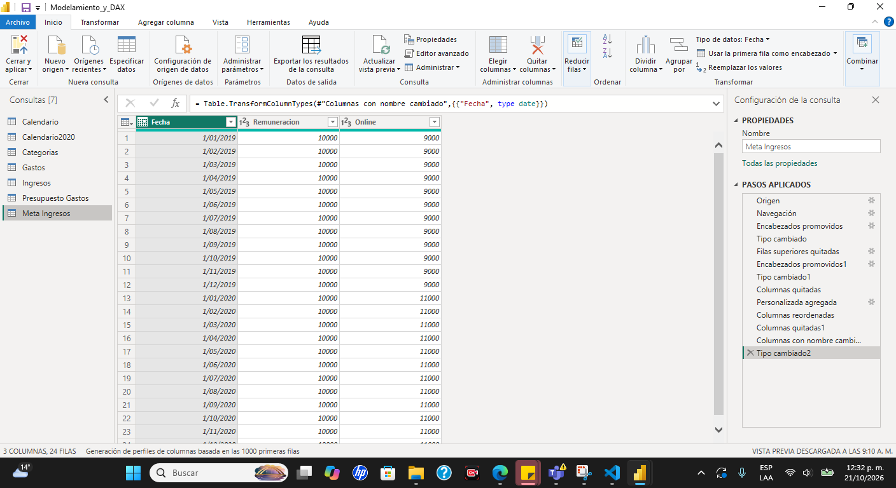<br/>
<sub>Meta Ingresos</sub>
</p>

</details>

---

## 🧩 Modelo de datos

El modelo tiene **7 tablas, 7 relaciones y 15 medidas**, con forma de **estrella**: `Calendario` (por `Fecha`) y `Categorias` (por `Categoria`) son las dimensiones que filtran a las tablas de hechos `Gastos`, `Ingresos` y `Presupuesto Gastos`.

<p align="center">
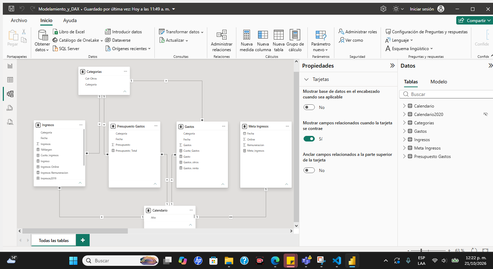
</p>

| Desde | Cardinalidad | Hacia |
|---|:---:|---|
| Gastos (Fecha) | `*` → `1` | Calendario (Fecha) |
| Ingresos (Fecha) | `*` → `1` | Calendario (Fecha) |
| Presupuesto Gastos (Fecha) | `*` → `1` | Calendario (Fecha) |
| Gastos (Categoria) | `*` → `1` | Categorias (Categoria) |
| Ingresos (Categoria) | `*` → `1` | Categorias (Categoria) |
| Presupuesto Gastos (Categoria) | `*` → `1` | Categorias (Categoria) |
| Calendario (Fecha) | `1` ↔ `1` (ambas direcciones) | Meta Ingresos (Fecha) |

<details>
<summary><b>📸 Ventana «Administrar relaciones»</b></summary>
<br/>
<p align="center">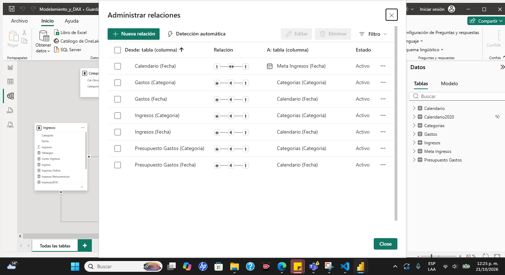</p>
</details>

---

## 🧮 Fórmulas DAX

Son las **15 medidas reales** del `.pbix`. Despliega cada grupo para ver la captura de la barra de fórmulas.

### 1️⃣ Medidas base

```dax
Ingreso            = SUM ( Ingresos[Ingresos] )
Gasto              = SUM ( Gastos[Gastos] )
Presupuesto_Total  = SUM ( 'Presupuesto Gastos'[Presupuesto] )
Meta_ingresos      = SUM ( 'Meta Ingresos'[Remuneracion] ) + SUM ( 'Meta Ingresos'[Online] )
```

<details>
<summary><b>📸 Capturas</b></summary>
<br/>

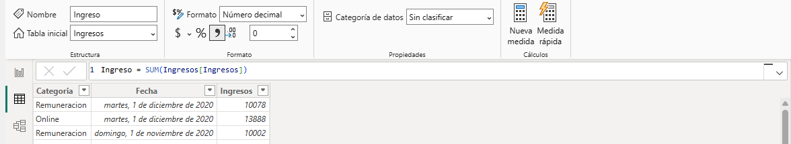
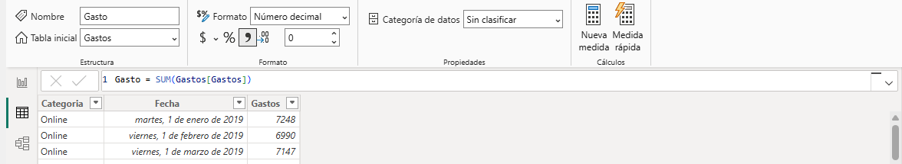
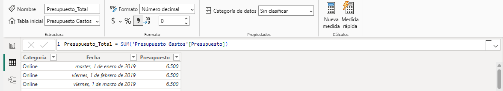
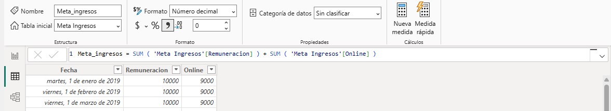

</details>

### 2️⃣ Resultado y cumplimiento

```dax
Utilidad       = [Ingreso] - [Gasto]
%Margen        = DIVIDE ( [Utilidad], Ingresos[Ingreso] )
Cuota_ingresos = DIVIDE ( [Ingreso], [Meta_ingresos] )
Cuota_Gastos   = DIVIDE ( [Gasto], [Presupuesto_Total] )
```

<details>
<summary><b>📸 Capturas</b></summary>
<br/>

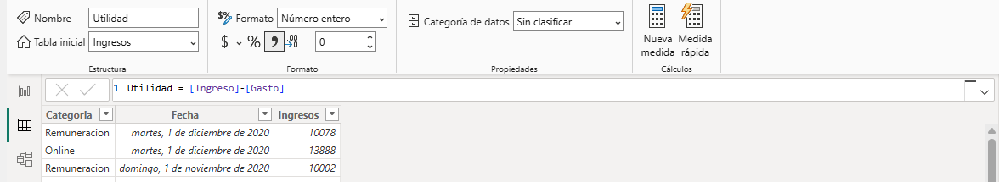
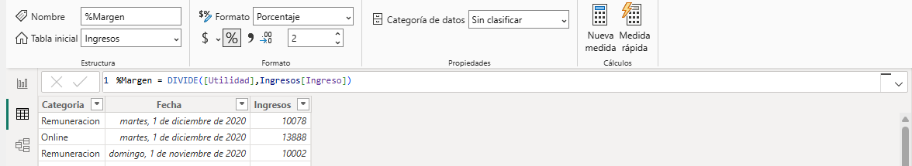
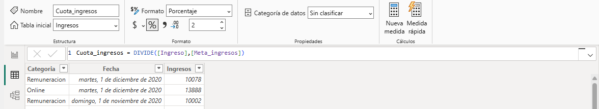
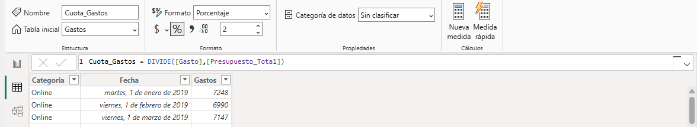

</details>

### 3️⃣ Medidas con filtro (`CALCULATE`)

```dax
Ingresos Online       = CALCULATE ( [Ingreso], Ingresos[Categoria] = "Online" )
Ingresos Remuneracion = CALCULATE ( [Ingreso], Ingresos[Categoria] = "Remuneracion" )
Gastos_renta          = CALCULATE ( [Gasto], Gastos[Categoria] = "Renta" )
Gastos_otros          = CALCULATE ( [Gasto], Categorias[Cat-Otros] = "Otros" )
```

<details>
<summary><b>📸 Capturas</b></summary>
<br/>

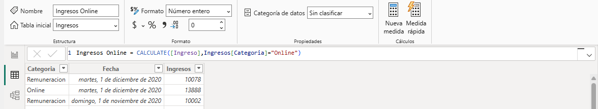
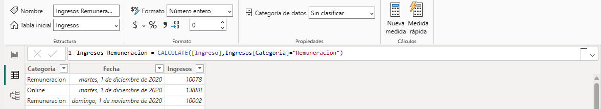
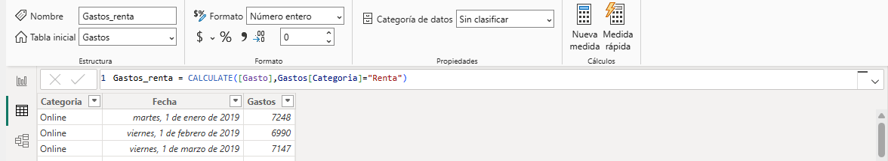
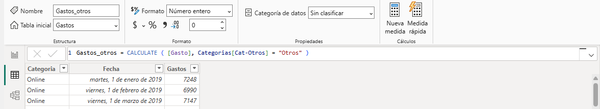

</details>

### 4️⃣ Comparación por año

```dax
Ingresos2019 = CALCULATE ( [Ingreso], Calendario[Fecha] = 2019 )
Ingresos2020 = CALCULATE ( [Ingreso], Calendario[Fecha] = 2020 )
Online2020   = CALCULATE ( [Ingreso], Ingresos[Categoria] = "Online", Calendario[Fecha] = 2020 )
```

<details>
<summary><b>📸 Capturas</b></summary>
<br/>

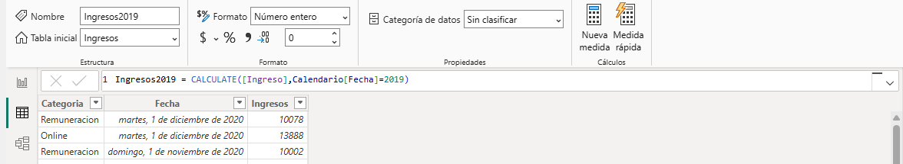

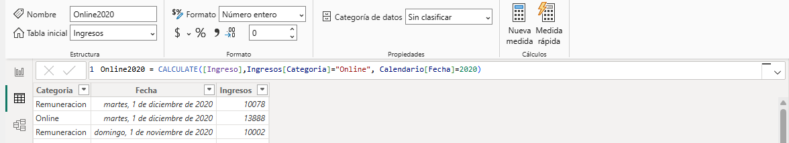

</details>

### 🔧 Funciones DAX utilizadas

| Función | Uso |
|---|---|
| `SUM` | Totales de ingresos, gastos, presupuesto y meta |
| `DIVIDE` | Margen y cumplimiento (evita errores de división entre cero) |
| `CALCULATE` | Ingresos y gastos por categoría o por año |

---

## 🔗 Match fuente ↔ modelo ↔ tablero

| Dato | Medida DAX | Dónde se ve |
|---|---|---|
| 💵 Ingresos | `Ingreso` | Tarjeta Ingreso, líneas, indicador de cuota |
| 💸 Gastos | `Gasto` | Tarjeta Gasto, líneas, barras por categoría |
| 📈 Ingresos − Gastos | `Utilidad`, `%Margen` | Tarjetas Utilidad y %Margen |
| 🎯 Meta de ingresos | `Meta_ingresos`, `Cuota_ingresos` | Indicador *Cuota de ingresos*, KPI *Ingresos vs Meta* |
| 🧾 Presupuesto de gastos | `Presupuesto_Total`, `Cuota_Gastos` | Indicador *Cuota de gastos* |
| 📅 Calendario (`Año`, `Inicio del mes`) | — (eje) | Segmentación de año y eje de tiempo de las líneas |
| 🏷️ Categorías | — (eje) | Barras *Gasto por Categoría* |

---

## 🚀 Cómo usar el proyecto

1. **Clona** el repositorio.
2. Abre `Modelamiento_y_DAX.pbix` con **Power BI Desktop**.
3. Si pide la ruta de origen: *Transformar datos → Configuración del origen de datos* y apunta a tu archivo de datos.

---

<div align="center">

**Herramientas:** Power BI Desktop · Power Query · DAX
**Autora:** [@Diana1295Dev](https://github.com/Diana1295Dev)

</div>
