# 📊 Power BI · Modelamiento de Datos y DAX para KPIs de RRHH

Guía técnica del tablero `Reporte_DAX.pbix`: cómo se modeló la data, qué fórmulas DAX alimentan cada KPI y cómo se ve el resultado. **Las capturas son reales**, tomadas del propio Power BI Desktop.

> Documentación general del proyecto: [README_Proyecto.md](README_Proyecto.md)

## Índice
1. [Flujo de trabajo](#1-flujo-de-trabajo)
2. [Power Query: transformación](#2-power-query-transformación)
3. [Modelo de datos](#3-modelo-de-datos)
4. [Fórmulas DAX](#4-fórmulas-dax)
5. [Tablero: páginas y KPIs](#5-tablero-páginas-y-kpis)

---

## 1. Flujo de trabajo

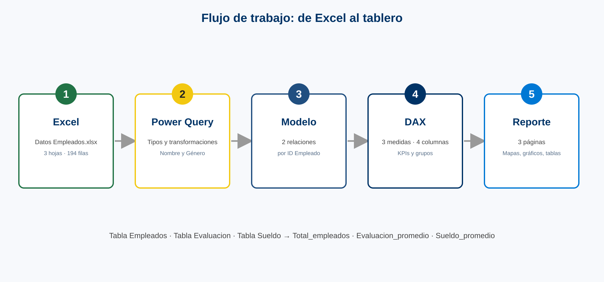

| Paso | Qué se hizo |
|---|---|
| 1. Obtener datos | Importar `Datos Empleados.xlsx` (3 hojas, 194 filas cada una) |
| 2. Transformar | Power Query: promover encabezados, tipos, dividir y combinar nombre, traducir género |
| 3. Modelar | 2 relaciones 1:1 por `ID Empleado` |
| 4. Calcular | 3 medidas y 4 columnas calculadas en DAX |
| 5. Visualizar | 3 páginas: Colaboradores, Sueldos y Evaluación |

---

## 2. Power Query: transformación

Las tres hojas se cargan como consultas independientes (`Consultas [3]`).

### Tabla Empleados
Pasos aplicados: **Origen → Navegación → Encabezados promovidos → Tipo cambiado → Dividir columna por delimitador → Tipo cambiado1 → Columnas combinadas → Valor reemplazado → Valor reemplazado1**.

- *Dividir columna* y *Columnas combinadas*: el nombre original viene como `Apellido, Nombre` (por ejemplo `Spirea, Kelley`) y se reordena a `Nombre Apellido` en la columna `Nombre_Empleado` (`Kelley Spirea`).
- *Valor reemplazado*: se traduce `Género` con `Table.ReplaceValue(…, "Male", "Hombre", …)` y `"Female"` → `"Mujer"`.

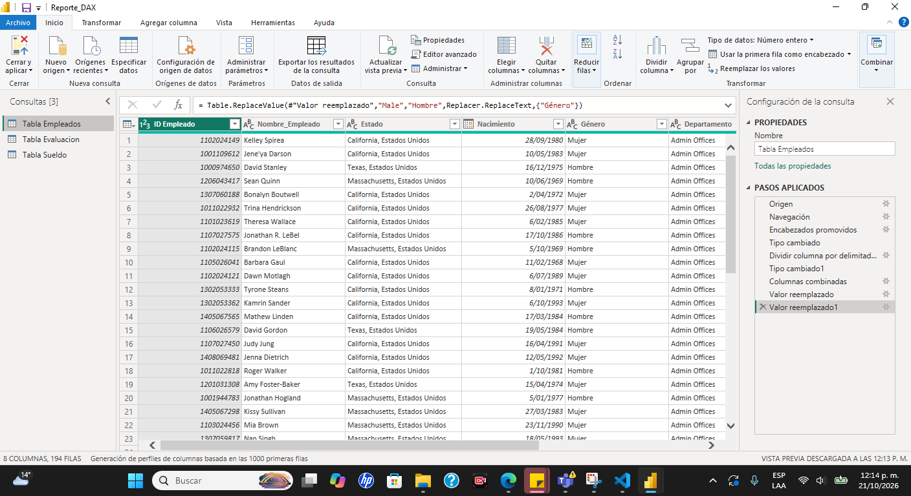

### Tabla Evaluacion y Tabla Sueldo
Pasos: **Origen → Navegación → Encabezados promovidos → Tipo cambiado** (`ID Empleado` como entero; `Evaluación` como número decimal y `Sueldo` como entero).

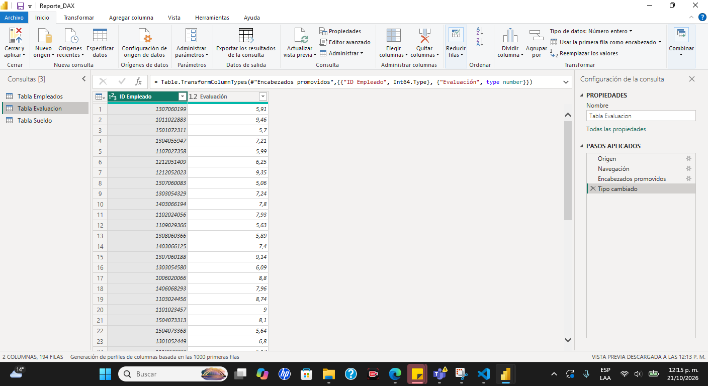


---

## 3. Modelo de datos

**Tabla Empleados** es la tabla central. Se conecta con **Tabla Evaluacion** y **Tabla Sueldo** mediante relaciones **1 : 1** por `ID Empleado`, con filtro cruzado en **ambas direcciones** (se ve el icono ◄► en las líneas de relación).


La vista de tabla muestra los datos ya transformados, junto con las columnas calculadas `Edad` y `Grupo edad`:

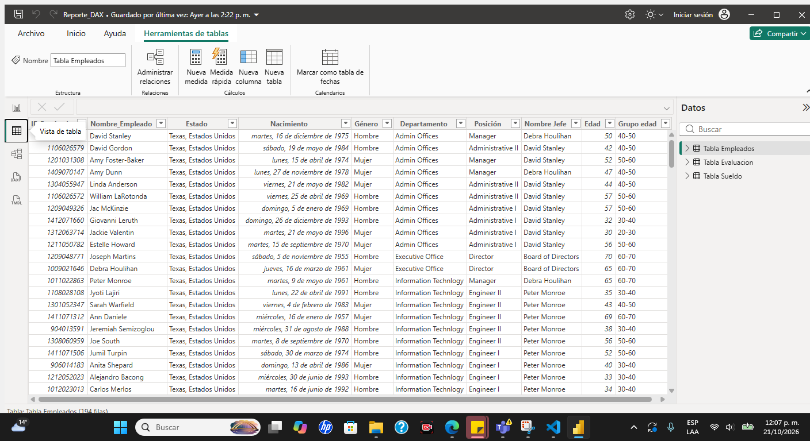

El modelo tiene **3 tablas, 3 medidas y 2 relaciones**.

---

## 4. Fórmulas DAX

Todas las fórmulas son las reales del `.pbix`. Cada una tiene su captura de la barra de fórmulas.

### 4.1 Medidas (KPIs)

**Total_empleados** · tabla `Tabla Empleados`
```dax
Total_empleados = COUNTROWS ( 'Tabla Empleados' )
```
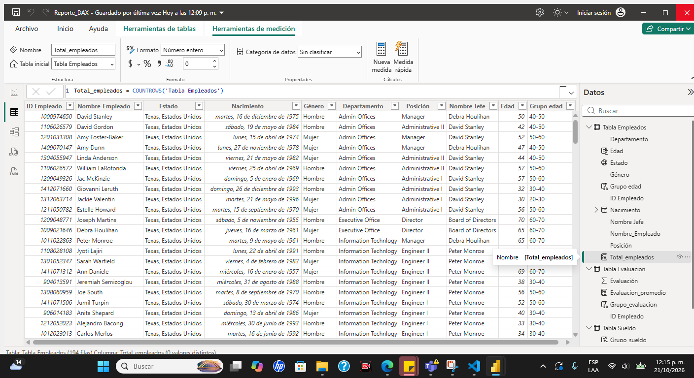

**Evaluacion_promedio** · tabla `Tabla Evaluacion`
```dax
Evaluacion_promedio = AVERAGE ( 'Tabla Evaluacion'[Evaluación] )
```
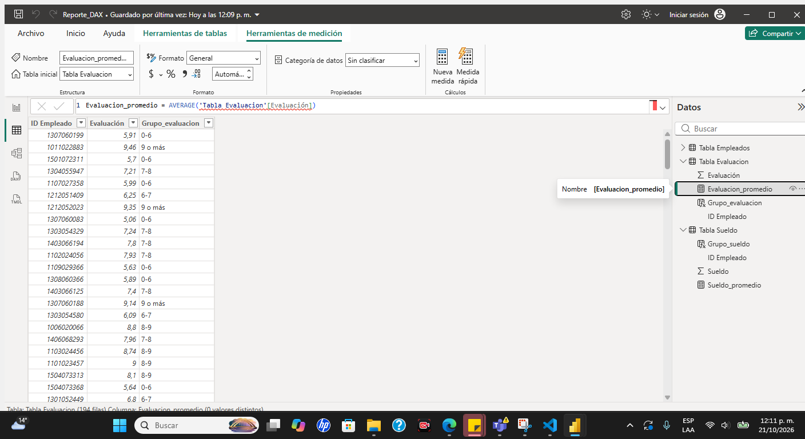

**Sueldo_promedio** · tabla `Tabla Sueldo`
```dax
Sueldo_promedio = AVERAGE ( 'Tabla Sueldo'[Sueldo] )
```
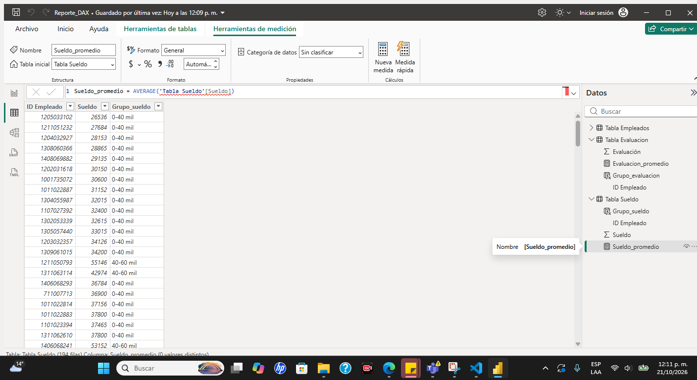

### 4.2 Columnas calculadas (segmentación)

**Edad**
```dax
Edad = INT ( YEARFRAC ( 'Tabla Empleados'[Nacimiento], TODAY () ) )
```
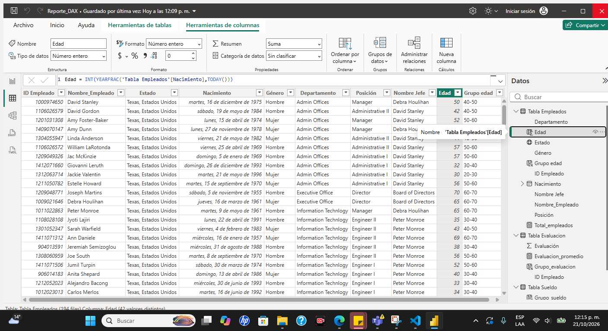

**Grupo edad**
```dax
Grupo edad =
IF ( 'Tabla Empleados'[Edad] <= 30, "20-30",
IF ( 'Tabla Empleados'[Edad] <= 40, "30-40",
IF ( 'Tabla Empleados'[Edad] <= 50, "40-50",
IF ( 'Tabla Empleados'[Edad] <= 60, "50-60",
IF ( 'Tabla Empleados'[Edad] <= 70, "60-70",
"70+" )))))
```
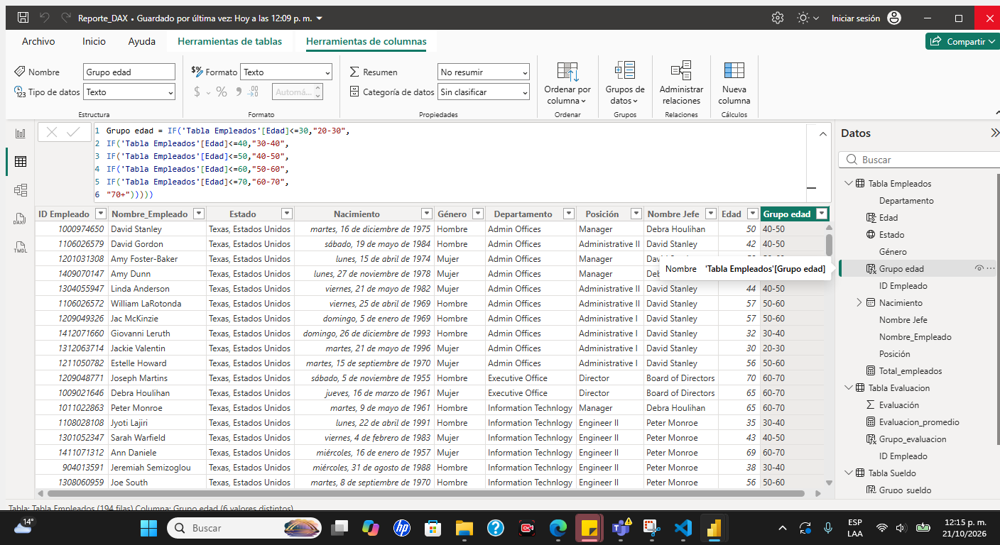

**Grupo_evaluacion**
```dax
Grupo_evaluacion =
IF ( 'Tabla Evaluacion'[Evaluación] <= 6, "0-6",
IF ( 'Tabla Evaluacion'[Evaluación] <= 7, "6-7",
IF ( 'Tabla Evaluacion'[Evaluación] <= 8, "7-8",
IF ( 'Tabla Evaluacion'[Evaluación] <= 9, "8-9",
"9 o más" ))))
```
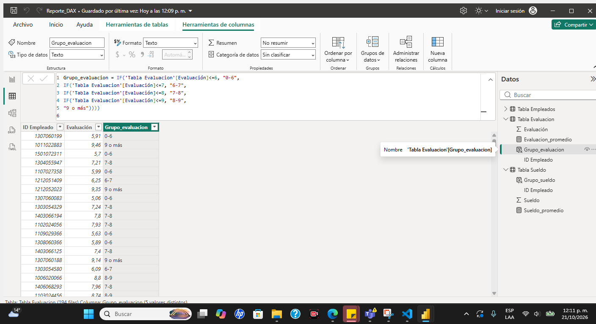

**Grupo_sueldo**
```dax
Grupo_sueldo =
IF ( 'Tabla Sueldo'[Sueldo] <= 40000, "0-40 mil",
IF ( 'Tabla Sueldo'[Sueldo] <= 60000, "40-60 mil",
IF ( 'Tabla Sueldo'[Sueldo] <= 80000, "60-80 mil",
IF ( 'Tabla Sueldo'[Sueldo] <= 100000, "80-100 mil",
"100 mil o más" ))))
```
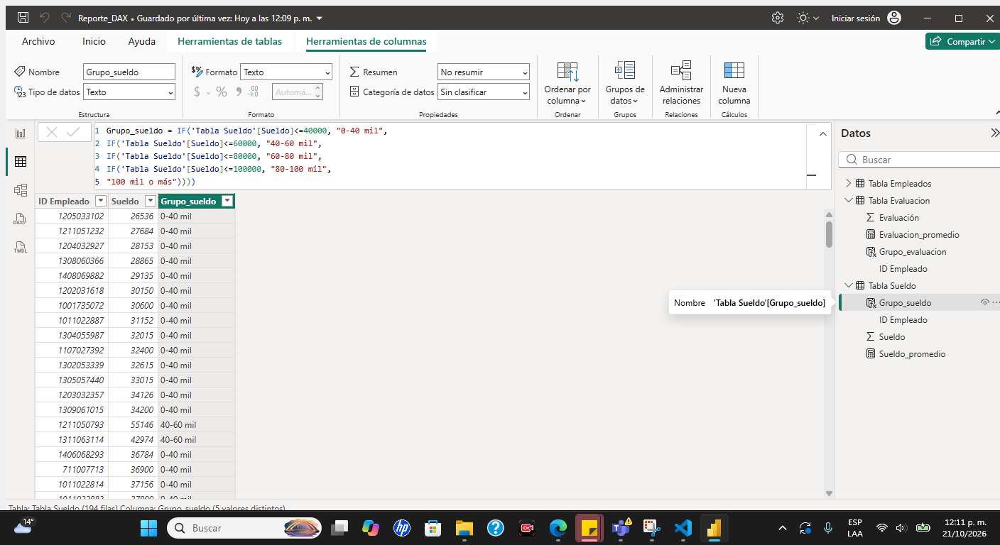

### 4.3 Qué fórmula alimenta qué KPI

| KPI / visual | Fórmula | Funciones DAX |
|---|---|---|
| Total empleados (tarjeta, donut, mapa, columnas, barras) | `Total_empleados` | `COUNTROWS` |
| Evaluación promedio (tarjeta, columnas, barras) | `Evaluacion_promedio` | `AVERAGE` |
| Sueldo promedio (tarjeta, tabla) | `Sueldo_promedio` | `AVERAGE` |
| Promedio de edad (tarjeta) y dispersión Edad vs Sueldo | `Edad` | `INT`, `YEARFRAC`, `TODAY` |
| Empleados por rango de edad | `Grupo edad` | `IF` anidado |
| Empleados por rango de evaluación | `Grupo_evaluacion` | `IF` anidado |
| Empleados por rango de sueldo | `Grupo_sueldo` | `IF` anidado |

Las tarjetas **Sueldo** (suma) y **Evaluación** (mínimo y máximo) no usan medidas DAX: son agregaciones de la columna hechas directamente en el visual.

---

## 5. Tablero: páginas y KPIs

Las tres páginas comparten el mismo diseño: botones de navegación arriba, título «Informe Recursos Humanos», tarjetas KPI y visuales de detalle. Los visuales se filtran entre sí.

### 5.1 Total Colaboradores
KPIs: **194** empleados · **7,56** evaluación promedio · **74,72 mil** sueldo promedio · **45,72** promedio de edad.
Visuales: total por género (dona), por estado (mapa), por departamento (columnas), por `Grupo edad`, `Grupo_evaluacion` y `Grupo_sueldo` (barras) y tabla de detalle.


### 5.2 Análisis de Sueldos
KPIs: **194** empleados · **74,72 mil** sueldo promedio · **14 mill.** suma de sueldo.
Visuales: sueldo por género (dona), por estado (mapa), por departamento (columnas), dispersión *Sueldo y Edad por Empleado* y tabla de detalle.

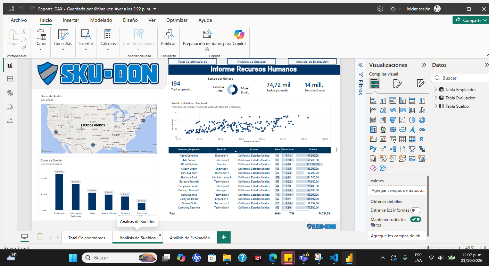

### 5.3 Análisis de Evaluación
KPIs: **194** empleados · **7,56** evaluación promedio · **5,01** mínima · **9,93** máxima.
Visuales: evaluación por jefe (barras), por género (columnas), por departamento (columnas), mapa por estado y tabla de detalle.

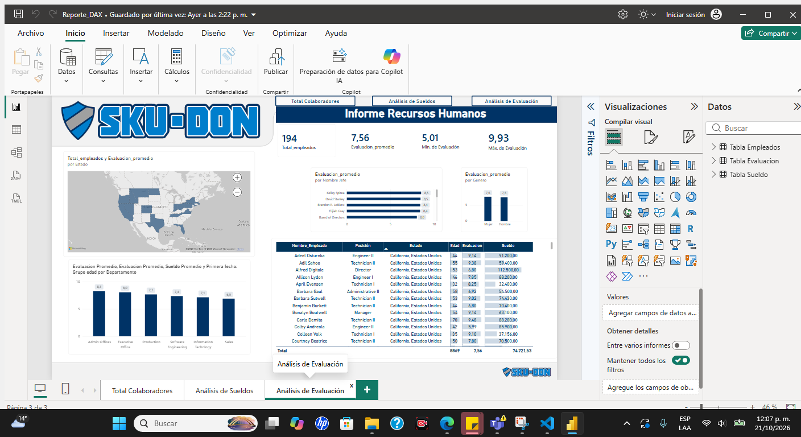

---

**Herramientas:** Power BI Desktop · Power Query · DAX · Excel
**Autora:** [@Diana1295Dev](https://github.com/Diana1295Dev)
