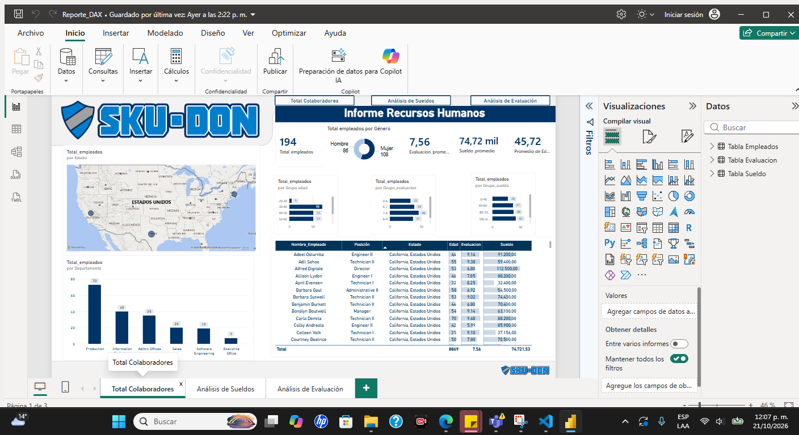
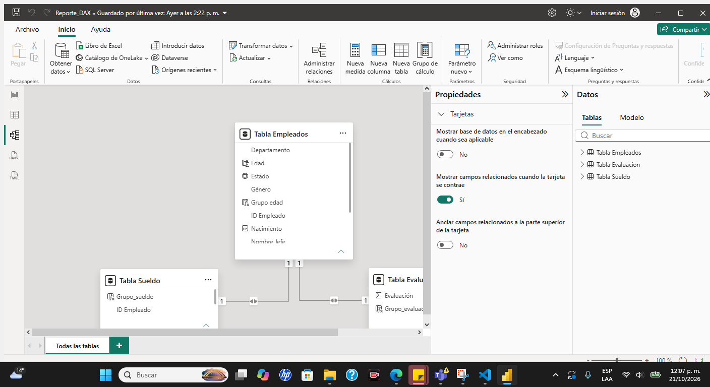

# 📈 Proyecto Power BI · Modelamiento de Datos y DAX

Repositorio con **dos reportes de Power BI** construidos con el mismo flujo: **fuente de datos → Power Query → modelo relacional → medidas DAX → tablero de KPIs**. Todas las capturas son reales, tomadas de Power BI Desktop.


## 📁 Contenido del repositorio

| Archivo | Descripción |
|---|---|
| `Modelamiento_y_DAX.pbix` | **Reporte financiero**: ingresos, gastos, utilidad, metas y presupuesto (sección 1) |
| `Reporte_DAX.pbix` | **Reporte de RRHH**: colaboradores, sueldos y evaluación (sección 2) |
| `Datos Empleados.xlsx` | Fuente de datos del reporte de RRHH |
| [README_Modelamiento.md](README_Modelamiento.md) | Detalle técnico del reporte de RRHH: Power Query, modelo y DAX |
| `images/` | Capturas de Power BI |

---

# 1. 💰 Reporte financiero · `Modelamiento_y_DAX.pbix`

Tablero para seguir **ingresos, gastos y utilidad** de 2019 y 2020 contra su **meta** y su **presupuesto**.


## 1.1 KPIs del tablero

| KPI | Valor | Medida DAX |
|---|---|---|
| Ingreso | 494.535 | `Ingreso` |
| Gasto | 361.917 | `Gasto` |
| Utilidad | 132.618 | `Utilidad` |
| % Margen | 26,82 % | `%Margen` |
| Cuota de ingresos (indicador) | 103,03 % (ingreso 494.535 vs meta 480.000) | `Cuota_ingresos` |
| Cuota de gastos (indicador) | 101,21 % (gasto 361.917 vs presupuesto 357.600) | `Cuota_Gastos` |
| Ingresos vs Meta, último mes | 23.966 (objetivo 21.000, +14,12 %) | `Ingreso`, `Meta_ingresos` |

Otros visuales: segmentación por **Año** (2019 / 2020), línea *Ingreso y Gasto por Mes* y barras *Gasto por Categoría* (Online 155.369 · Renta 84.000 · Comida 36.246 · Electricidad 23.264 · Entretenimiento 20.930 · Transporte 19.298).

## 1.2 Power Query

Siete consultas, cada una con sus pasos aplicados:

| Consulta | Filas | Pasos clave |
|---|---|---|
| `Calendario` | 731 | Consulta anexada con `Calendario2020`; se agregan `Inicio del mes` y `Año` (`Date.Year([Fecha])`) |
| `Calendario2020` | — | Segunda mitad del calendario; queda oculta en el modelo porque solo sirve para el anexo |
| `Categorias` | 10 | Encabezados promovidos y tipos de texto; `Cat-Otros` agrupa todas las categorías como «Otros» excepto «Online» |
| `Gastos` | 216 | Filas superiores quitadas, encabezados promovidos, columna sobrante quitada y `Cantidad` renombrada a `Gastos` |
| `Ingresos` | 48 | Mismo patrón: `Cantidad` renombrada a `Ingresos` |
| `Presupuesto Gastos` | 216 | Anulación de dinamización de columnas, columna personalizada, reordenar columnas y `FECHA` renombrada a `Fecha` |
| `Meta Ingresos` | 24 | Columna personalizada, reordenar y quitar columnas, `Fecha` como tipo fecha |

**Calendario** (731 filas, de 2019 a 2020): Origen → Navegación → Encabezados promovidos → Tipo cambiado → Consulta anexada → Columnas con nombre cambiado → Inicio del mes insertado → Año insertado.


| Categorias | Gastos |
|---|---|
|  |  |

| Ingresos | Presupuesto Gastos |
|---|---|
|  |  |


## 1.3 Modelo de datos

El modelo tiene **7 tablas, 7 relaciones y 15 medidas**. Tiene forma de estrella: **Calendario** (por `Fecha`) y **Categorias** (por `Categoria`) son las dimensiones que filtran a las tablas de hechos `Gastos`, `Ingresos` y `Presupuesto Gastos`.


| Desde | Cardinalidad | Hacia |
|---|---|---|
| Gastos (Fecha) | * → 1 | Calendario (Fecha) |
| Ingresos (Fecha) | * → 1 | Calendario (Fecha) |
| Presupuesto Gastos (Fecha) | * → 1 | Calendario (Fecha) |
| Gastos (Categoria) | * → 1 | Categorias (Categoria) |
| Ingresos (Categoria) | * → 1 | Categorias (Categoria) |
| Presupuesto Gastos (Categoria) | * → 1 | Categorias (Categoria) |
| Calendario (Fecha) | 1 ↔ 1 (ambas direcciones) | Meta Ingresos (Fecha) |


## 1.4 Fórmulas DAX

Son las 15 medidas reales del `.pbix`; cada una tiene su captura de la barra de fórmulas.

### Medidas base

```dax
Ingreso            = SUM ( Ingresos[Ingresos] )
Gasto              = SUM ( Gastos[Gastos] )
Presupuesto_Total  = SUM ( 'Presupuesto Gastos'[Presupuesto] )
Meta_ingresos      = SUM ( 'Meta Ingresos'[Remuneracion] ) + SUM ( 'Meta Ingresos'[Online] )
```


### Resultado y cumplimiento

```dax
Utilidad       = [Ingreso] - [Gasto]
%Margen        = DIVIDE ( [Utilidad], Ingresos[Ingreso] )
Cuota_ingresos = DIVIDE ( [Ingreso], [Meta_ingresos] )
Cuota_Gastos   = DIVIDE ( [Gasto], [Presupuesto_Total] )
```


### Medidas con filtro (`CALCULATE`)

```dax
Ingresos Online       = CALCULATE ( [Ingreso], Ingresos[Categoria] = "Online" )
Ingresos Remuneracion = CALCULATE ( [Ingreso], Ingresos[Categoria] = "Remuneracion" )
Gastos_renta          = CALCULATE ( [Gasto], Gastos[Categoria] = "Renta" )
Gastos_otros          = CALCULATE ( [Gasto], Categorias[Cat-Otros] = "Otros" )
```


### Comparación por año

```dax
Ingresos2019 = CALCULATE ( [Ingreso], Calendario[Fecha] = 2019 )
Ingresos2020 = CALCULATE ( [Ingreso], Calendario[Fecha] = 2020 )
Online2020   = CALCULATE ( [Ingreso], Ingresos[Categoria] = "Online", Calendario[Fecha] = 2020 )
```


### Funciones DAX utilizadas

| Función | Uso |
|---|---|
| `SUM` | Totales de ingresos, gastos, presupuesto y meta |
| `DIVIDE` | Margen y cumplimiento (evita errores de división entre cero) |
| `CALCULATE` | Ingresos y gastos por categoría o por año |

## 1.5 Match fuente ↔ modelo ↔ tablero

| Dato | Medida DAX | Dónde se ve |
|---|---|---|
| Ingresos | `Ingreso` | Tarjeta Ingreso, líneas, indicador de cuota |
| Gastos | `Gasto` | Tarjeta Gasto, líneas, barras por categoría |
| Ingresos − Gastos | `Utilidad`, `%Margen` | Tarjetas Utilidad y %Margen |
| Meta de ingresos | `Meta_ingresos`, `Cuota_ingresos` | Indicador *Cuota de ingresos*, KPI *Ingresos vs Meta* |
| Presupuesto de gastos | `Presupuesto_Total`, `Cuota_Gastos` | Indicador *Cuota de gastos* |
| Calendario (`Año`, `Inicio del mes`) | — (eje) | Segmentación de año y eje de tiempo de las líneas |
| Categorías | — (eje) | Barras *Gasto por Categoría* |

---

# 2. 👥 Reporte de RRHH · `Reporte_DAX.pbix`

Análisis de **194 colaboradores** desde `Datos Empleados.xlsx` (hojas Empleados, Evaluación y Sueldo, relacionadas por `ID Empleado`), en 3 páginas: **Total Colaboradores**, **Análisis de Sueldos** y **Análisis de Evaluación**.



| KPI | Valor | Medida DAX |
|---|---|---|
| Total de empleados | 194 | `Total_empleados = COUNTROWS('Tabla Empleados')` |
| Evaluación promedio | 7,56 | `Evaluacion_promedio = AVERAGE('Tabla Evaluacion'[Evaluación])` |
| Sueldo promedio | 74,72 mil | `Sueldo_promedio = AVERAGE('Tabla Sueldo'[Sueldo])` |
| Promedio de edad | 45,72 | `Edad = INT(YEARFRAC([Nacimiento], TODAY()))` |

Además usa tres columnas calculadas con `IF` anidados (`Grupo edad`, `Grupo_evaluacion`, `Grupo_sueldo`) para segmentar en rangos.



📘 **Power Query, relaciones, fórmulas y las 3 páginas con capturas:** [README_Modelamiento.md](README_Modelamiento.md)

---

## Cómo usar el proyecto
1. Clona el repositorio.
2. Abre el `.pbix` que quieras con **Power BI Desktop**.
3. Si pide la ruta de origen: *Transformar datos → Configuración del origen de datos* y apunta a tu archivo de datos (en RRHH, `Datos Empleados.xlsx`).

**Herramientas:** Power BI Desktop · Power Query · DAX · Excel
**Autora:** [@Diana1295Dev](https://github.com/Diana1295Dev)
